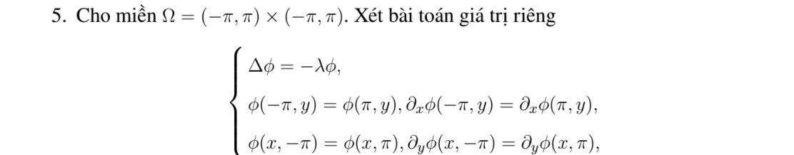
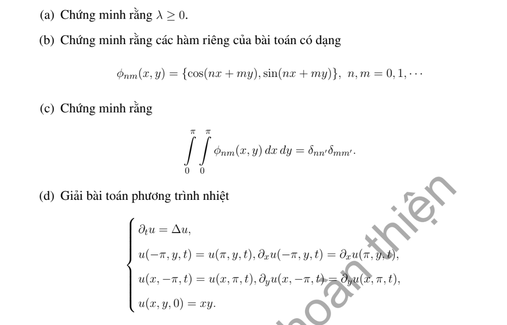

# Bài tập thực hành 5 — Mục 5.6.3

**Mã:** `BT_5_6_3_05` · **Trang sách:** 263–264

[← Mục lục](../MUC_LUC.md) · [Bản PDF của bài](BT_5_6_3_05.pdf)

## Đề bài

## Kiến thức và trình tự giải

**Bước 1 — Chọn bài trị riêng đúng biên.** Giải $-L\phi=\lambda\phi$. Nếu có trôi $Au_x$, phép đổi ẩn mũ đưa về toán tử tự liên hợp nhưng đồng thời đổi điều kiện Neumann thành Robin; cần giữ sự thay đổi này.

**Bước 2 — Trực giao và hệ số.** Nếu toán tử tự liên hợp với trọng số $\sigma$, hệ số của $q$ là $q_n=\int q\phi_n\sigma/\int\phi_n^2\sigma$. Trong hình chữ nhật, hàm riêng thường là tích hai hàm một chiều và trị riêng là tổng hai trị riêng.

**Bước 3 — Giải mode của bài PDE.** Nhiệt cho $T_n'+\lambda_nT_n=H_n$; Poisson cho $-\lambda_nT_n=H_n$ sau khử biên; sóng cho $T_n''+\lambda_nT_n=H_n$. Mode 0, phổ liên tục và dữ liệu đầu dư phải xét riêng, không áp công thức chia cho $\lambda_n$ một cách máy móc.

## Lời giải áp dụng cho bài

**Ý (a).**  Tích phân trên chu kỳ cho $\lambda\int|\phi|^2=\int|\nabla\phi|^2\ge0$.

**Ý (b).**  Cơ sở đầy đủ là $e^{i(nx+my)}$, $n,m\in\mathbb Z$, $\lambda=n^2+m^2$; phần thực là cos/sin của $nx+my$. Chỉ lấy $n,m\ge0$ như đề sẽ bỏ các mode $nx-my$.

**Ý (c).**  Tích phân trực giao cần tích hai hàm (hoặc liên hợp) và hệ số chuẩn hóa, không phải $\int\phi_{nm}$ đơn lẻ như dòng đề. Cơ sở chuẩn hóa $(2\pi)^{-1}e^{i(nx+my)}$ có $\int_{(-\pi,\pi)^2}\phi_{nm}\overline\phi_{n'm'}=\delta_{nn'}\delta_{mm'}$. Trên $(0,\pi)^2$, các sóng chéo đã in không thỏa công thức trực giao ấy nói chung.

**Ý (d).**  Fourier của $x$ trên $(-\pi,\pi)$ là $2\sum_{n\ge1}(-1)^{n+1}\sin nx/n$. Vì $xy$ là tích hai chuỗi,

$$
u=4\sum_{n,m\ge1}\frac{(-1)^{n+m}}{nm}e^{-(n^2+m^2)t}\sin nx\sin my.
$$

Giới hạn 0, nghiệm tuần hoàn trơn khi $t>0$; dữ liệu ban đầu được tuần hoàn hóa và có gián đoạn ở mép.

## Đối chiếu kết quả

Khi sử dụng kết quả, kiểm tra đồng thời phương trình, dữ liệu ban đầu/biên và miền được nêu trong lời giải. Các điều kiện về tính trơn, nghiệm thực, tồn tại hoặc duy nhất là một phần của kết luận; không bỏ chúng khi ghi đáp án.
