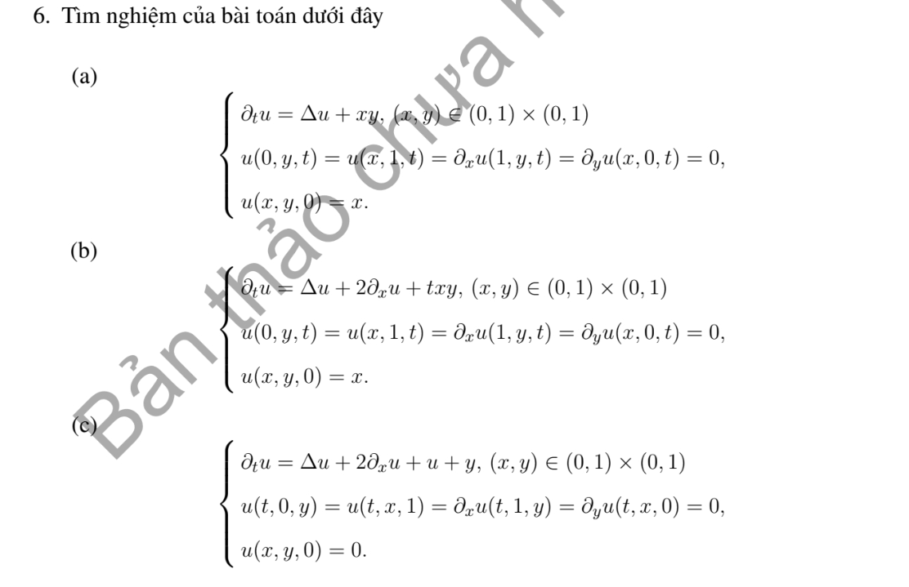

# Bài tập thực hành 6 — Mục 5.6.3

**Mã:** `BT_5_6_3_06` · **Trang sách:** 264–264

[← Mục lục](../MUC_LUC.md) · [Bản PDF của bài](BT_5_6_3_06.pdf)

## Đề bài

## Kiến thức và trình tự giải

**Bước 1 — Chọn bài trị riêng đúng biên.** Giải $-L\phi=\lambda\phi$. Nếu có trôi $Au_x$, phép đổi ẩn mũ đưa về toán tử tự liên hợp nhưng đồng thời đổi điều kiện Neumann thành Robin; cần giữ sự thay đổi này.

**Bước 2 — Trực giao và hệ số.** Nếu toán tử tự liên hợp với trọng số $\sigma$, hệ số của $q$ là $q_n=\int q\phi_n\sigma/\int\phi_n^2\sigma$. Trong hình chữ nhật, hàm riêng thường là tích hai hàm một chiều và trị riêng là tổng hai trị riêng.

**Bước 3 — Giải mode của bài PDE.** Nhiệt cho $T_n'+\lambda_nT_n=H_n$; Poisson cho $-\lambda_nT_n=H_n$ sau khử biên; sóng cho $T_n''+\lambda_nT_n=H_n$. Mode 0, phổ liên tục và dữ liệu đầu dư phải xét riêng, không áp công thức chia cho $\lambda_n$ một cách máy móc.

## Lời giải áp dụng cho bài

**Ý (a).**  Với $k_n=(n+1/2)\pi$, $\ell_m=(m+1/2)\pi$, $X_n=\sin k_nx,Y_m=\cos\ell_my$, $\lambda=k_n^2+\ell_m^2$, đặt

$$
f_{nm}=4\int_0^1\int_0^1xX_nY_m\,dxdy,\quad F_{nm}=4\int_0^1\int_0^1xyX_nY_m\,dxdy.
$$

Nghiệm $u=\sum[f_{nm}e^{-\lambda t}+F_{nm}(1-e^{-\lambda t})/\lambda]X_nY_m$.

**Ý (b).**  Đặt $u=e^{-x}v$. Toán tử thành $v_{xx}+v_{yy}-v$, với $v(0)=0,v_x(1)=v(1)$, $v_y(y=0)=0,v(y=1)=0$. Cơ sở $X_0=x$, $X_n=\sin k_nx$ với các nghiệm dương $\tan k_n=k_n$, và $Y_m=\cos\ell_my$. Đặt $\lambda_{nm}=k_n^2+1+\ell_m^2$ ($k_0=0$), $q_{nm}=\iint qX_nY_m/\iint X_n^2Y_m^2$. Dữ liệu của $v$ là $xe^x$, nguồn $txy e^x$:

$$
u=e^{-x}\sum X_nY_m\left[(xe^x)_{nm}e^{-\lambda t}+(xy e^x)_{nm}\left(\frac t\lambda-\frac{1-e^{-\lambda t}}{\lambda^2}\right)\right].
$$

**Ý (c).**  Dòng biến ở biên bị đảo thứ tự trong bản in; dùng cùng điều kiện hình học như (b). Sau $u=e^{-x}v$, hạng $+u$ khử $-v$, nguồn $ye^x$. Với $\Lambda=k_n^2+\ell_m^2>0$,

$$
u=e^{-x}\sum\frac{(ye^x)_{nm}}\Lambda(1-e^{-\Lambda t})X_nY_m.
$$

Các hệ số trên là tích phân một chiều của hàm sơ cấp, không chứa ẩn số chưa giải.

## Đối chiếu kết quả

Khi sử dụng kết quả, kiểm tra đồng thời phương trình, dữ liệu ban đầu/biên và miền được nêu trong lời giải. Các điều kiện về tính trơn, nghiệm thực, tồn tại hoặc duy nhất là một phần của kết luận; không bỏ chúng khi ghi đáp án.
