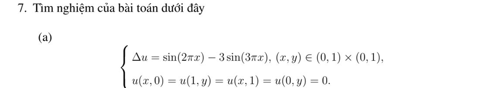
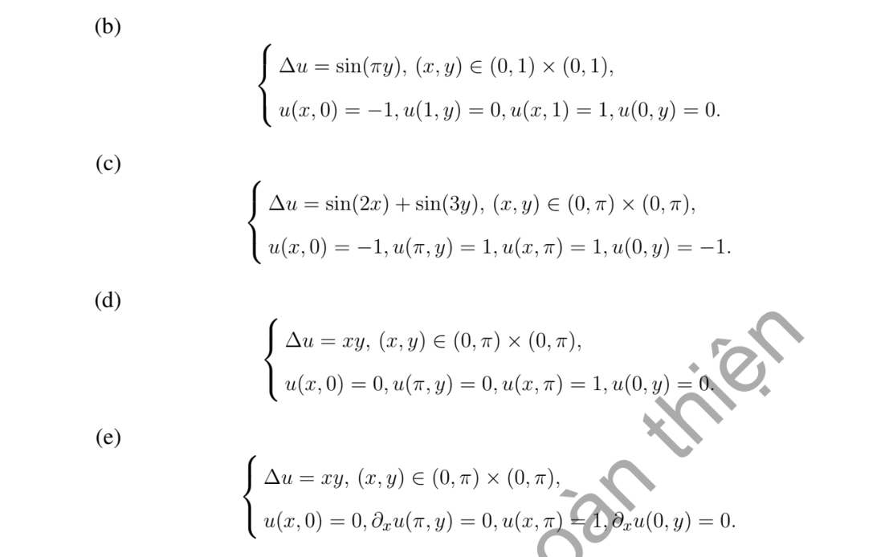

# Bài tập thực hành 7 — Mục 5.6.3

**Mã:** `BT_5_6_3_07` · **Trang sách:** 264–265

[← Mục lục](../MUC_LUC.md) · [Bản PDF của bài](BT_5_6_3_07.pdf)

## Đề bài

## Kiến thức và trình tự giải

**Bước 1 — Chọn bài trị riêng đúng biên.** Giải $-L\phi=\lambda\phi$. Nếu có trôi $Au_x$, phép đổi ẩn mũ đưa về toán tử tự liên hợp nhưng đồng thời đổi điều kiện Neumann thành Robin; cần giữ sự thay đổi này.

**Bước 2 — Trực giao và hệ số.** Nếu toán tử tự liên hợp với trọng số $\sigma$, hệ số của $q$ là $q_n=\int q\phi_n\sigma/\int\phi_n^2\sigma$. Trong hình chữ nhật, hàm riêng thường là tích hai hàm một chiều và trị riêng là tổng hai trị riêng.

**Bước 3 — Giải mode của bài PDE.** Nhiệt cho $T_n'+\lambda_nT_n=H_n$; Poisson cho $-\lambda_nT_n=H_n$ sau khử biên; sóng cho $T_n''+\lambda_nT_n=H_n$. Mode 0, phổ liên tục và dữ liệu đầu dư phải xét riêng, không áp công thức chia cho $\lambda_n$ một cách máy móc.

## Lời giải áp dụng cho bài

Đặt $\mathcal H$ là phép kéo dài điều hòa bốn cạnh trong hình chữ nhật theo công thức của bài 5.1.3.1, và $\mathcal H_N$ là phép kéo dài với hai cạnh đứng Neumann 0 (chuỗi cosine theo $x$, sinh theo $y$). Một nghiệm riêng $P$ cho nguồn giúp giải ngay $u=P+$phép kéo dài của dữ liệu biên trừ $P$.

**Ý (a).**  $P=-\sin2\pi x/(4\pi^2)+\sin3\pi x/(3\pi^2)$; $u=P+\mathcal H[-P,-P,0,0]$ trên hình vuông đơn vị.

**Ý (b).**  $P=-\sin\pi y/\pi^2$; $u=P+\mathcal H[-1,1,\sin\pi y/\pi^2,\sin\pi y/\pi^2]$.

**Ý (c).**  $P=-\sin2x/4-\sin3y/9$; $u=P+\mathcal H[-1+\sin2x/4,1+\sin2x/4,-1+\sin3y/9,1+\sin3y/9]$ trên $(0,\pi)^2$.

**Ý (d).**  $P=x^3y/6$; $u=P+\mathcal H[0,1-\pi x^3/6,0,-\pi^3y/6]$.

**Ý (e).**  Trên $(0,\pi)^2$, lấy cơ sở $X_n=\cos nx$, biên dưới 0, trên 1. Nguồn $F=xy$ có $F_0(y)=\pi y/2$, $F_n(y)=2[(-1)^n-1]y/(\pi n^2)$, $n\ge1$. Mode 0 $U_0=y/\pi+\pi(y^3-\pi^2y)/12$. Các mode $n\ge1$:

$$
U_n(y)=\int_0^\pi\frac{-\sinh(n\min(y,s))\sinh(n[\pi-\max(y,s)])}{n\sinh n\pi}F_n(s)ds.
$$

$u=U_0+\sum U_n\cos nx$. Biên Neumann theo $x$ thỏa tự động.

## Đối chiếu kết quả

Khi sử dụng kết quả, kiểm tra đồng thời phương trình, dữ liệu ban đầu/biên và miền được nêu trong lời giải. Các điều kiện về tính trơn, nghiệm thực, tồn tại hoặc duy nhất là một phần của kết luận; không bỏ chúng khi ghi đáp án.
