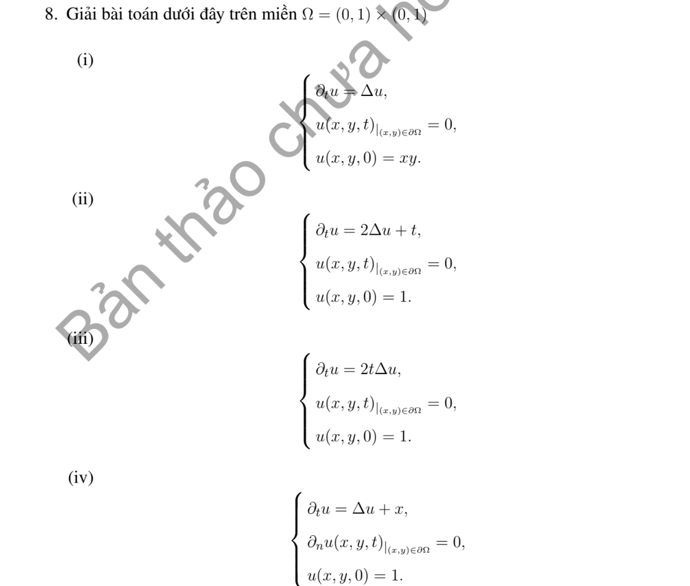
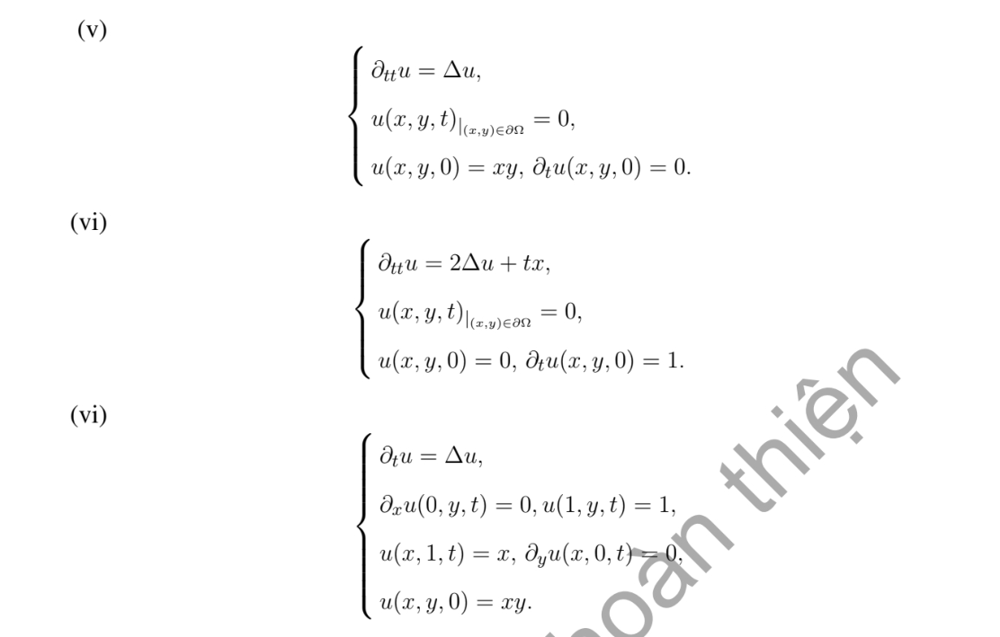

# Bài tập thực hành 8 — Mục 5.6.3

**Mã:** `BT_5_6_3_08` · **Trang sách:** 265–266

[← Mục lục](../MUC_LUC.md) · [Bản PDF của bài](BT_5_6_3_08.pdf)

## Đề bài

## Kiến thức và trình tự giải

**Bước 1 — Chọn bài trị riêng đúng biên.** Giải $-L\phi=\lambda\phi$. Nếu có trôi $Au_x$, phép đổi ẩn mũ đưa về toán tử tự liên hợp nhưng đồng thời đổi điều kiện Neumann thành Robin; cần giữ sự thay đổi này.

**Bước 2 — Trực giao và hệ số.** Nếu toán tử tự liên hợp với trọng số $\sigma$, hệ số của $q$ là $q_n=\int q\phi_n\sigma/\int\phi_n^2\sigma$. Trong hình chữ nhật, hàm riêng thường là tích hai hàm một chiều và trị riêng là tổng hai trị riêng.

**Bước 3 — Giải mode của bài PDE.** Nhiệt cho $T_n'+\lambda_nT_n=H_n$; Poisson cho $-\lambda_nT_n=H_n$ sau khử biên; sóng cho $T_n''+\lambda_nT_n=H_n$. Mode 0, phổ liên tục và dữ liệu đầu dư phải xét riêng, không áp công thức chia cho $\lambda_n$ một cách máy móc.

## Lời giải áp dụng cho bài

Đặt $S_{nm}=\sin n\pi x\sin m\pi y$, $\lambda_{nm}=\pi^2(n^2+m^2)$, $q_{nm}=4\iint qS_{nm}$. Các hệ số cần dùng: $(xy)_{nm}=4(-1)^{n+m}/(nm\pi^2)$; $(1)_{nm}=4(1-(-1)^n)(1-(-1)^m)/(nm\pi^2)$; $(x)_{nm}=4(-1)^{n+1}(1-(-1)^m)/(nm\pi^2)$.

**Ý (i).**  $u=\sum(xy)_{nm}e^{-\lambda t}S_{nm}$.

**Ý (ii).**  $u=\sum(1)_{nm}[e^{-2\lambda t}+t/(2\lambda)-(1-e^{-2\lambda t})/(4\lambda^2)]S_{nm}$.

**Ý (iii).**  Đổi thời gian $\tau=t^2$: $u=\sum(1)_{nm}e^{-\lambda t^2}S_{nm}$.

**Ý (iv).**  Biên Neumann và dữ liệu 1: chỉ phụ thuộc $x$. Fourier cosine của $x$ là $1/2+\sum 2[(-1)^n-1]\cos n\pi x/(n^2\pi^2)$, nên

$$
u=1+t/2+\sum_{n\ge1}\frac{2[(-1)^n-1]}{n^4\pi^4}(1-e^{-n^2\pi^2t})\cos n\pi x.
$$

**Ý (v).**  Bản in ghi $u_t=\Delta u$ và còn cho $u_t(x,y,0)=0$. Trong miền mở, dữ liệu $xy$ có $\Delta(xy)=0$, nên điều kiện thêm tương thích và nghiệm chính là (i); không phải phương trình sóng nếu giữ dấu $u_t$.

**Ý (vi).**  Bản in ghi phương trình nhiệt $u_t=2\Delta u+tx$ với $u(0)=0$ nhưng $u_t(0)=1$. Thế $t=0$ vào phương trình trong miền buộc $u_t(0)=0$, nên không có nghiệm cổ điển thỏa cả hai điều kiện. Bỏ điều kiện dư sai cho

$$
u=\sum(x)_{nm}\left[\frac t{2\lambda}-\frac{1-e^{-2\lambda t}}{4\lambda^2}\right]S_{nm}.
$$

Nếu ý định là sóng $u_{tt}=2\Delta u+tx$, nghiệm là $\sum[(1)_{nm}\sin(\sqrt{2\lambda}t)/\sqrt{2\lambda}+(x)_{nm}(t/(2\lambda)-\sin(\sqrt{2\lambda}t)/(2\lambda)^{3/2})]S_{nm}$.

(vii, lần đánh số vi thứ hai) Đặt $u=P+w$, với $P$ điều hòa, $P_x(0)=P_y(y=0)=0,P(1,y)=1,P(x,1)=x$. Tính $P$ bằng chồng hai chuỗi cos nửa nguyên: $X_n=\cos((n+1/2)\pi x)$; phép kéo dài cạnh trên $x$ có hệ số $2\int_0^1xX_n dx$, nhân $\cosh(k_ny)/\cosh k_n$; phép kéo dài cạnh phải 1 tương tự theo $y$. Sau đó

$$
u=P+\sum c_{nm}e^{-(k_n^2+k_m^2)t}\cos k_nx\cos k_my,\quad c_{nm}=4\iint(xy-P)\cos k_nx\cos k_my.
$$

## Đối chiếu kết quả

Khi sử dụng kết quả, kiểm tra đồng thời phương trình, dữ liệu ban đầu/biên và miền được nêu trong lời giải. Các điều kiện về tính trơn, nghiệm thực, tồn tại hoặc duy nhất là một phần của kết luận; không bỏ chúng khi ghi đáp án.
