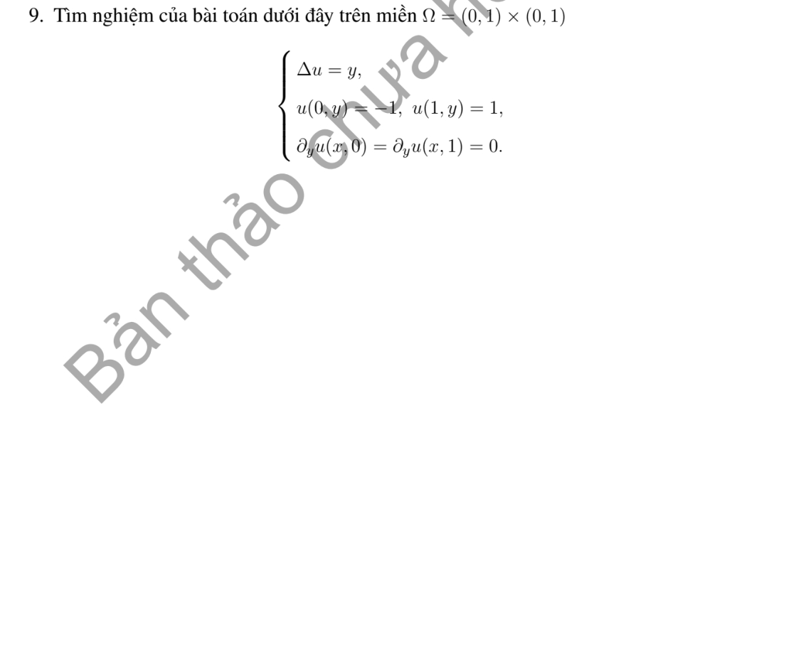

# Bài tập thực hành 9 — Mục 5.6.3

**Mã:** `BT_5_6_3_09` · **Trang sách:** 266–266

[← Mục lục](../MUC_LUC.md) · [Bản PDF của bài](BT_5_6_3_09.pdf)

## Đề bài

## Kiến thức và trình tự giải

**Bước 1 — Chọn bài trị riêng đúng biên.** Giải $-L\phi=\lambda\phi$. Nếu có trôi $Au_x$, phép đổi ẩn mũ đưa về toán tử tự liên hợp nhưng đồng thời đổi điều kiện Neumann thành Robin; cần giữ sự thay đổi này.

**Bước 2 — Trực giao và hệ số.** Nếu toán tử tự liên hợp với trọng số $\sigma$, hệ số của $q$ là $q_n=\int q\phi_n\sigma/\int\phi_n^2\sigma$. Trong hình chữ nhật, hàm riêng thường là tích hai hàm một chiều và trị riêng là tổng hai trị riêng.

**Bước 3 — Giải mode của bài PDE.** Nhiệt cho $T_n'+\lambda_nT_n=H_n$; Poisson cho $-\lambda_nT_n=H_n$ sau khử biên; sóng cho $T_n''+\lambda_nT_n=H_n$. Mode 0, phổ liên tục và dữ liệu đầu dư phải xét riêng, không áp công thức chia cho $\lambda_n$ một cách máy móc.

## Lời giải áp dụng cho bài

Đặt $u=2x-1+w$. Khi đó $w(0,y)=w(1,y)=0$, $w_y(x,0)=w_y(x,1)=0$, $\Delta w=y$. Cosine của $y$ trên $(0,1)$ có $a_0=1/2$, $a_n=2[(-1)^n-1]/(n^2\pi^2)$. Mode 0 $w_0=x(x-1)/4$. Với $k_n=n\pi$,

$$
w_n=\frac{a_n}{k_n^2}\left[\frac{\cosh(k_n(x-1/2))}{\cosh(k_n/2)}-1\right].
$$

Vậy $u=2x-1+x(x-1)/4+\sum_{n\ge1}w_n(x)\cos n\pi y$. Mỗi mode giải $w_n''-k_n^2w_n=a_n$, đúng biên, chứng minh công thức.

## Đối chiếu kết quả

Khi sử dụng kết quả, kiểm tra đồng thời phương trình, dữ liệu ban đầu/biên và miền được nêu trong lời giải. Các điều kiện về tính trơn, nghiệm thực, tồn tại hoặc duy nhất là một phần của kết luận; không bỏ chúng khi ghi đáp án.
