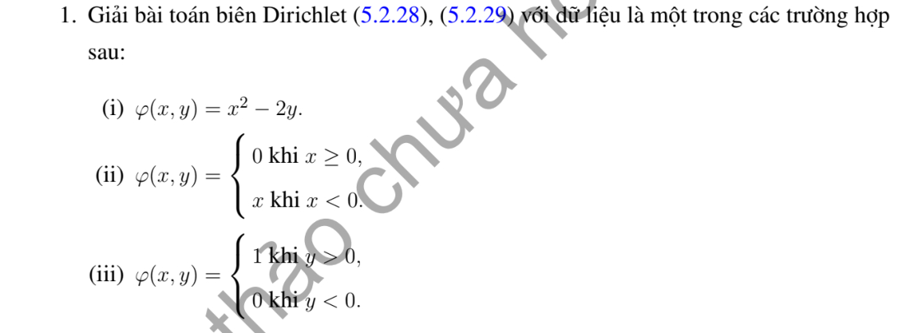

# Ví dụ 1 — Mục 5.2.2

**Mã:** `VD_5_2_2_01` · **Trang sách:** 241–241

[← Mục lục](../MUC_LUC.md) · [Bản PDF của bài](VD_5_2_2_01.pdf)

## Đề bài và phần trình bày có sẵn trong sách

## Kiến thức và trình tự giải

**Bước 1 — Viết toán tử theo tọa độ cực.**

$$\Delta u=u_{rr}+\frac1r u_r+\frac1{r^2}u_{\theta\theta}.$$

Với mode $\cos n\theta,\sin n\theta$, phương trình xuyên tâm thuần nhất có hai nghiệm $r^n,r^{-n}$; mode 0 có $1,\log r$. Trên đĩa chứa tâm, tính chính quy loại $r^{-n}$ và $\log r$; trên vành khuyên giữ cả hai.

**Bước 2 — Dùng dữ liệu.** Khai triển Fourier dữ liệu trên đường tròn để tìm hệ số; mỗi mode trên đĩa nhân $(r/R)^n$. Trên hình quạt, điều kiện ở hai cạnh góc xác định tần số $n\pi/\alpha$. Với Neumann, $\partial_\nu=\partial_r$ trên cung ngoài, còn trên cạnh góc là $\pm r^{-1}\partial_\theta$.

**Bước 3 — Nguồn và tương thích.** Tách một nghiệm riêng của $\Delta P=F$, rồi giải bài điều hòa cho $u-P$. Tổng thông lượng ngoài phải bằng tích phân nguồn đối với Neumann; mode hằng thể hiện đúng điều kiện này.

## Lời giải áp dụng cho bài

Ví dụ chưa có lời giải trong bản in. Với đĩa bán kính $R$, dùng phép kéo dài điều hòa $\mathcal P_R[\varphi]$:

$$
\mathcal P_R[\varphi](r,\theta)=\frac{R^2-r^2}{2\pi}\int_0^{2\pi}\frac{\varphi(R\cos s,R\sin s)}{R^2+r^2-2Rr\cos(\theta-s)}ds.
$$

**Ý (i).**  $u=(R^2+x^2-y^2)/2-2y$.

**Ý (ii).**  Biên $\min(x,0)=(x-|x|)/2$ cho

$$
u=\frac x2-\frac R\pi-\frac{2R}\pi\sum_{n\ge1}\frac{(-1)^{n+1}(r/R)^{2n}}{4n^2-1}\cos2n\theta.
$$

**Ý (iii).**  $u=1/2+(2/\pi)\sum_{n\text{ lẻ}}(r/R)^n\sin n\theta/n$. Các công thức đến từ Fourier của dữ liệu trên đường tròn; mọi nghiệm đều bị chặn tại tâm.

