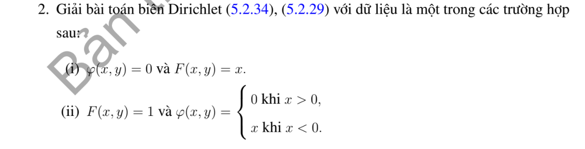

# Ví dụ 2 — Mục 5.2.2

**Mã:** `VD_5_2_2_02` · **Trang sách:** 241–241

[← Mục lục](../MUC_LUC.md) · [Bản PDF của bài](VD_5_2_2_02.pdf)

## Đề bài và phần trình bày có sẵn trong sách

## Kiến thức và trình tự giải

**Bước 1 — Viết toán tử theo tọa độ cực.**

$$\Delta u=u_{rr}+\frac1r u_r+\frac1{r^2}u_{\theta\theta}.$$

Với mode $\cos n\theta,\sin n\theta$, phương trình xuyên tâm thuần nhất có hai nghiệm $r^n,r^{-n}$; mode 0 có $1,\log r$. Trên đĩa chứa tâm, tính chính quy loại $r^{-n}$ và $\log r$; trên vành khuyên giữ cả hai.

**Bước 2 — Dùng dữ liệu.** Khai triển Fourier dữ liệu trên đường tròn để tìm hệ số; mỗi mode trên đĩa nhân $(r/R)^n$. Trên hình quạt, điều kiện ở hai cạnh góc xác định tần số $n\pi/\alpha$. Với Neumann, $\partial_\nu=\partial_r$ trên cung ngoài, còn trên cạnh góc là $\pm r^{-1}\partial_\theta$.

**Bước 3 — Nguồn và tương thích.** Tách một nghiệm riêng của $\Delta P=F$, rồi giải bài điều hòa cho $u-P$. Tổng thông lượng ngoài phải bằng tích phân nguồn đối với Neumann; mode hằng thể hiện đúng điều kiện này.

## Lời giải áp dụng cho bài

**Ý (i).**  $u=x(x^2+y^2-R^2)/8$, vì $\Delta[x(x^2+y^2)]=8x$, và biên 0.

**Ý (ii).**  $u=(r^2-R^2)/4+\mathcal P_R[\min(x,0)]$, với $\mathcal P_R$ có chuỗi ở ví dụ trước. Hạng đầu có Laplace bằng 1 và biên 0, hạng sau điều hòa và đúng dữ liệu biên.

