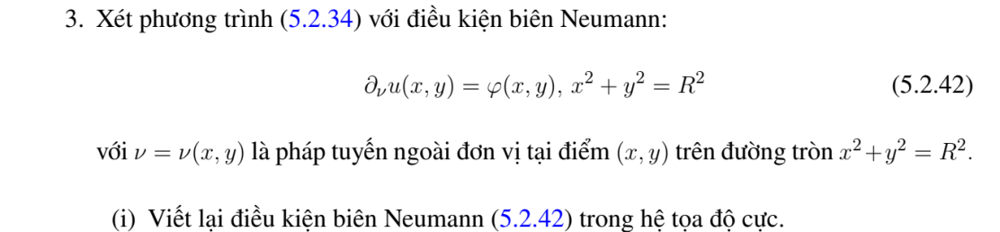
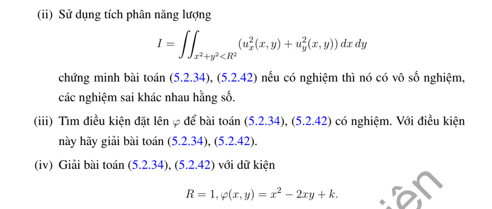

# Ví dụ 3 — Mục 5.2.2

**Mã:** `VD_5_2_2_03` · **Trang sách:** 241–242

[← Mục lục](../MUC_LUC.md) · [Bản PDF của bài](VD_5_2_2_03.pdf)

## Đề bài và phần trình bày có sẵn trong sách

## Kiến thức và trình tự giải

**Bước 1 — Viết toán tử theo tọa độ cực.**

$$\Delta u=u_{rr}+\frac1r u_r+\frac1{r^2}u_{\theta\theta}.$$

Với mode $\cos n\theta,\sin n\theta$, phương trình xuyên tâm thuần nhất có hai nghiệm $r^n,r^{-n}$; mode 0 có $1,\log r$. Trên đĩa chứa tâm, tính chính quy loại $r^{-n}$ và $\log r$; trên vành khuyên giữ cả hai.

**Bước 2 — Dùng dữ liệu.** Khai triển Fourier dữ liệu trên đường tròn để tìm hệ số; mỗi mode trên đĩa nhân $(r/R)^n$. Trên hình quạt, điều kiện ở hai cạnh góc xác định tần số $n\pi/\alpha$. Với Neumann, $\partial_\nu=\partial_r$ trên cung ngoài, còn trên cạnh góc là $\pm r^{-1}\partial_\theta$.

**Bước 3 — Nguồn và tương thích.** Tách một nghiệm riêng của $\Delta P=F$, rồi giải bài điều hòa cho $u-P$. Tổng thông lượng ngoài phải bằng tích phân nguồn đối với Neumann; mode hằng thể hiện đúng điều kiện này.

## Lời giải áp dụng cho bài

**Ý (i).**  Pháp tuyến ngoài trên đường tròn là $e_r$, nên biên $u_r(R,\theta)=\varphi(R\cos\theta,R\sin\theta)$.

**Ý (ii).**  Hiệu $w$ có $\Delta w=0,\partial_\nu w=0$; Green cho $\int|\nabla w|^2=0$, nên mọi nghiệm sai khác hằng.

**Ý (iii).**  Với $\Delta u=F$, điều kiện cần và đủ Neumann là $\int_{\partial D}\varphi=\int_DF$. Có thể giải bằng một nghiệm riêng $P$ của $\Delta P=F$, rồi khai triển biên $h=\varphi-P_r$ có trung bình 0:

$$
u=P+C+\sum_{n\ge1}\frac{r^n}{nR^{n-1}}(h_n^c\cos n\theta+h_n^s\sin n\theta).
$$

Nếu $F$ chưa được chỉ định trong đề thì kết quả phải phụ thuộc $F$ như công thức này.

**Ý (iv).**  Khi $F=0,R=1$, trung bình $x^2-2xy+k$ là $1/2+k$, nên $k=-1/2$; nghiệm $u=(x^2-y^2)/4-xy+C$. Nếu $F$ khác 0, phải thay điều kiện $k$ bằng $\int_DF/(2\pi)-1/2$ và thêm nghiệm riêng; bản in không ghi $F$ cho câu này.

