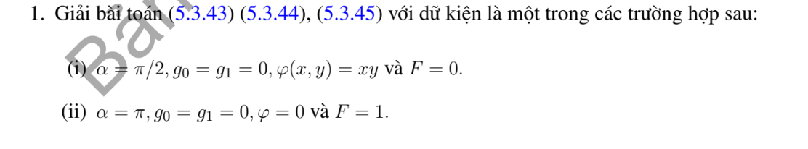

# Ví dụ 1 — Mục 5.3.2

**Mã:** `VD_5_3_2_01` · **Trang sách:** 244–244

[← Mục lục](../MUC_LUC.md) · [Bản PDF của bài](VD_5_3_2_01.pdf)

## Đề bài và phần trình bày có sẵn trong sách

## Kiến thức và trình tự giải

**Bước 1 — Viết toán tử theo tọa độ cực.**

$$\Delta u=u_{rr}+\frac1r u_r+\frac1{r^2}u_{\theta\theta}.$$

Với mode $\cos n\theta,\sin n\theta$, phương trình xuyên tâm thuần nhất có hai nghiệm $r^n,r^{-n}$; mode 0 có $1,\log r$. Trên đĩa chứa tâm, tính chính quy loại $r^{-n}$ và $\log r$; trên vành khuyên giữ cả hai.

**Bước 2 — Dùng dữ liệu.** Khai triển Fourier dữ liệu trên đường tròn để tìm hệ số; mỗi mode trên đĩa nhân $(r/R)^n$. Trên hình quạt, điều kiện ở hai cạnh góc xác định tần số $n\pi/\alpha$. Với Neumann, $\partial_\nu=\partial_r$ trên cung ngoài, còn trên cạnh góc là $\pm r^{-1}\partial_\theta$.

**Bước 3 — Nguồn và tương thích.** Tách một nghiệm riêng của $\Delta P=F$, rồi giải bài điều hòa cho $u-P$. Tổng thông lượng ngoài phải bằng tích phân nguồn đối với Neumann; mode hằng thể hiện đúng điều kiện này.

## Lời giải áp dụng cho bài

Với hình quạt $0<r<R,0<\theta<\alpha$, đặt $b=(1-\theta/\alpha)g_0(r)+(\theta/\alpha)g_1(r)$, $w=u-b$, $H=F-\Delta b$, $h(\theta)=\varphi(\theta)-b(R,\theta)$. Đặt $k_n=n\pi/\alpha$, $H_n=2\alpha^{-1}\int_0^\alpha H\sin k_n\theta$, $h_n$ tương tự. Khi đó

$$
u=b+\sum_{n\ge1}\left[h_n(r/R)^{k_n}+\int_0^R\mathcal G_n(r,s)H_n(s)s\,ds\right]\sin k_n\theta,
$$

$$
\mathcal G_n=-\frac1{2k_n}\left[(r_</r_>)^{k_n}-(r_<r_>/R^2)^{k_n}\right].
$$

Đây là Green của ODE xuyên tâm, bị chặn tại 0 và bằng 0 tại $R$. Năng lượng Dirichlet cho duy nhất. Để nghiệm liên tục tại đỉnh, $g_0(0)=g_1(0)$ và dữ liệu phải tương thích.
Câu cụ thể (i) $\alpha=\pi/2,F=0,g_0=g_1=0,\varphi=xy$: $u=xy$ vì điều hòa và đúng cả ba biên. (ii) $\alpha=\pi,F=1$, mọi biên 0: đặt $k_n=n$, $H_n=2(1-(-1)^n)/(\pi n)$. Với $n$ lẻ,

$$
u=\sum_{n\text{ lẻ}}\frac{H_n}{4-n^2}[r^2-R^2(r/R)^n]\sin n\theta.
$$

Các mode chẵn bằng 0; mode cộng hưởng $n=2$ không có nguồn nên không xuất hiện. Thế Laplace cho $1$.

