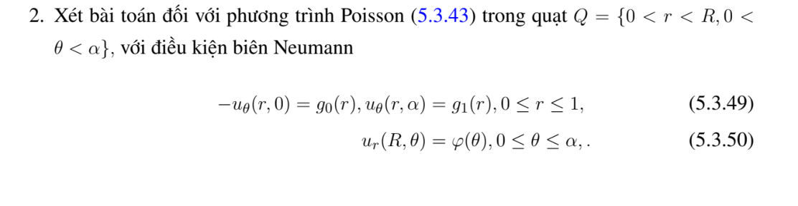
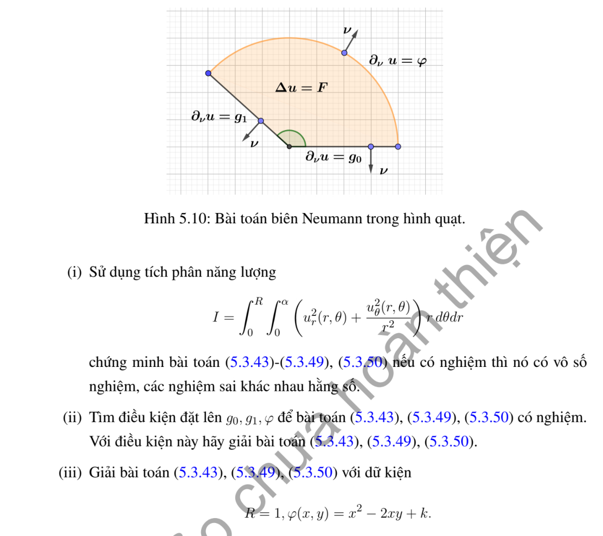

# Ví dụ 2 — Mục 5.3.2

**Mã:** `VD_5_3_2_02` · **Trang sách:** 244–245

[← Mục lục](../MUC_LUC.md) · [Bản PDF của bài](VD_5_3_2_02.pdf)

## Đề bài và phần trình bày có sẵn trong sách

## Kiến thức và trình tự giải

**Bước 1 — Viết toán tử theo tọa độ cực.**

$$\Delta u=u_{rr}+\frac1r u_r+\frac1{r^2}u_{\theta\theta}.$$

Với mode $\cos n\theta,\sin n\theta$, phương trình xuyên tâm thuần nhất có hai nghiệm $r^n,r^{-n}$; mode 0 có $1,\log r$. Trên đĩa chứa tâm, tính chính quy loại $r^{-n}$ và $\log r$; trên vành khuyên giữ cả hai.

**Bước 2 — Dùng dữ liệu.** Khai triển Fourier dữ liệu trên đường tròn để tìm hệ số; mỗi mode trên đĩa nhân $(r/R)^n$. Trên hình quạt, điều kiện ở hai cạnh góc xác định tần số $n\pi/\alpha$. Với Neumann, $\partial_\nu=\partial_r$ trên cung ngoài, còn trên cạnh góc là $\pm r^{-1}\partial_\theta$.

**Bước 3 — Nguồn và tương thích.** Tách một nghiệm riêng của $\Delta P=F$, rồi giải bài điều hòa cho $u-P$. Tổng thông lượng ngoài phải bằng tích phân nguồn đối với Neumann; mode hằng thể hiện đúng điều kiện này.

## Lời giải áp dụng cho bài

Trong bản in, biên cạnh là $-u_\theta(r,0)=g_0(r),u_\theta(r,\alpha)=g_1(r)$; thông lượng pháp tuyến thực tế lần lượt là $g_0/r,g_1/r$, vì đạo hàm theo góc có thừa số $1/r$. Biên cung có thông lượng $\varphi$. Green cho duy nhất modulo hằng. Điều kiện tương thích:

$$
\int_0^R\frac{g_0+g_1}{r}dr+R\int_0^\alpha\varphi(\theta)d\theta=\int_0^R\int_0^\alpha F(r,\theta)r\,d\theta dr.
$$

Có thể khử biên cạnh bằng $b$ rồi khai triển cosine $\cos(n\pi\theta/\alpha)$; mỗi hệ số giải $(rW_n')'-k_n^2W_n/r=r(F-\Delta b)_n$, với đạo hàm đã cho tại $R$. Mode 0 chính là điều kiện tương thích trên, hằng tích phân còn lại tùy ý.

Câu (iii) của ví dụ chỉ ghi $R=1,\varphi=x^2-2xy+k$; chưa ghi $F,\alpha,g_0,g_1$. Vì vậy không đủ xác định một nghiệm cụ thể trong hình quạt. Khi các dữ liệu đó được chọn, phương trình trên xác định $k$ và các hệ số. Nếu ý định là đĩa toàn phần, $F=0$, thì $k=-1/2,u=(x^2-y^2)/4-xy+C$ như ví dụ 5.2.2.3; đây là một bài đã sửa, không phải dữ kiện gốc.

