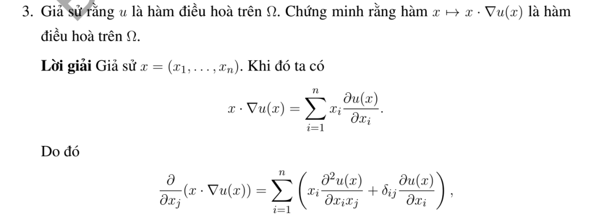
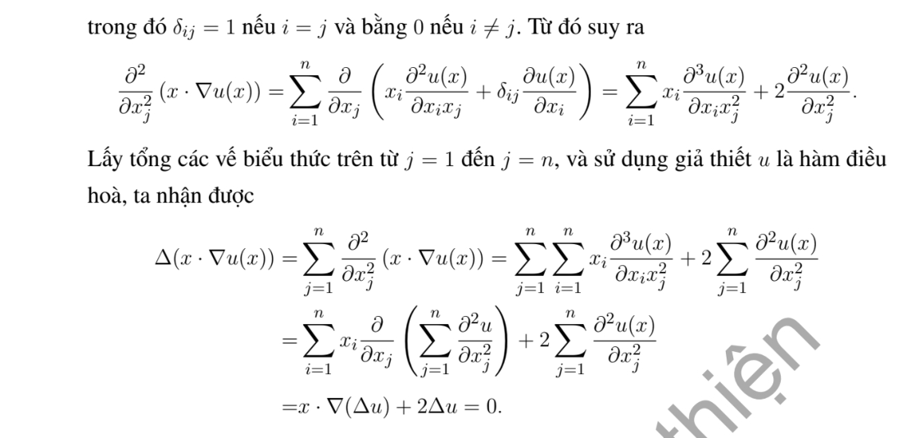

# Ví dụ 3 — Mục 5.4.2

**Mã:** `VD_5_4_2_03` · **Trang sách:** 248–249

[← Mục lục](../MUC_LUC.md) · [Bản PDF của bài](VD_5_4_2_03.pdf)

## Đề bài và phần trình bày có sẵn trong sách

## Kiến thức và trình tự giải

**Các công cụ dùng trong chứng minh.** Với hai hàm đủ trơn,

$$\Delta(uv)=u\Delta v+v\Delta u+2\nabla u\cdot\nabla v.$$

Với hàm xuyên tâm $u=f(r)$ trong $\mathbb R^n$,

$$\Delta u=f''(r)+\frac{n-1}{r}f'(r).$$

Tính giá trị trung bình và công thức Poisson cho phép suy cận nội của đạo hàm. Khi dùng liên thông, tính trơn tại tâm hoặc tăng trưởng ở vô cực, phải nêu giả thiết tương ứng; bỏ một giả thiết có thể làm kết luận sai.

## Lời giải trong tài liệu

Lời giải/đáp án có sẵn được giữ đầy đủ trong ảnh phía trên. Phần kiến thức vừa nêu giải thích trình tự phương pháp để đối chiếu từng phép biến đổi của ví dụ.

