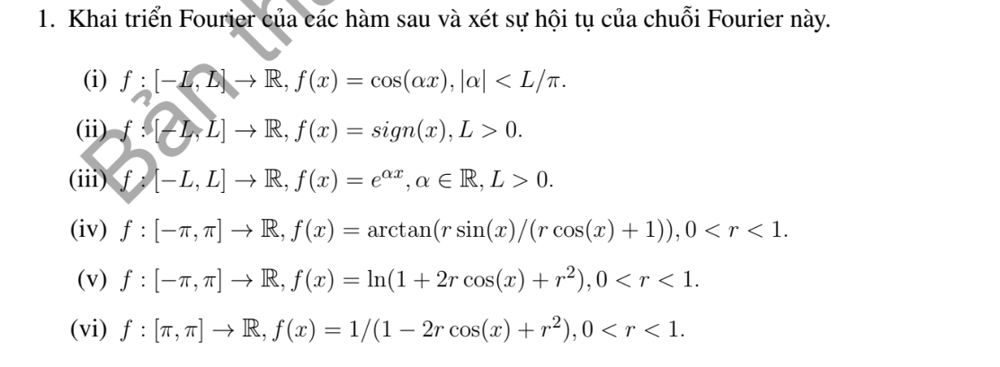

# Bài tập thực hành 1 — Mục 6.1.1.2

**Mã:** `BT_6_1_1_2_01` · **Trang sách:** 274–274

[← Mục lục](../MUC_LUC.md) · [Bản PDF của bài](BT_6_1_1_2_01.pdf)

## Đề bài

## Kiến thức và trình tự giải

**Bước 1 — Chốt quy ước.** Trên $[-L,L]$, dùng $f=a_0+\sum_{n\ge1}(a_n\cos(n\pi x/L)+b_n\sin(n\pi x/L))$, với

$$a_0=\frac1{2L}\int_{-L}^Lf,\quad a_n=\frac1L\int_{-L}^Lf\cos\frac{n\pi x}{L},\quad b_n=\frac1L\int_{-L}^Lf\sin\frac{n\pi x}{L}.$$

**Bước 2 — Tính hệ số.** Hàm chẵn chỉ có cosine, hàm lẻ chỉ có sine. Hàm phân đoạn phải chia tích phân tại điểm đổi biểu thức. Dùng tích thành tổng, tích phân từng phần hoặc chuỗi hình học/log để tính hệ số.

**Bước 3 — Hội tụ và giá trị ở mép.** Với dữ liệu trơn từng khúc, chuỗi về giá trị hàm tại điểm liên tục, về trung bình hai giới hạn tại điểm nhảy. Khai triển sine/cosine trên $[0,L]$ tương ứng thác triển lẻ/chẵn; giá trị ở đầu mút phải xét theo thác triển, không mặc nhiên bằng dữ liệu ban đầu. Hệ số suy đủ nhanh cho hội tụ đều bằng tiêu chuẩn Weierstrass.

## Lời giải áp dụng cho bài

Dùng quy ước $f=a_0+\sum_{n\ge1}(a_n\cos k_nx+b_n\sin k_nx)$, $k_n=n\pi/L$, $a_0=(2L)^{-1}\int_{-L}^Lf$, $a_n=L^{-1}\int f\cos$, $b_n=L^{-1}\int f\sin$.

**Ý (i).**  $a_0=\sin(\alpha L)/(\alpha L)$, $a_n=2(-1)^n\alpha\sin(\alpha L)/[L(\alpha^2-k_n^2)]$, $b_n=0$. Ở $\alpha=0$ hoặc cộng hưởng, lấy giới hạn (hàm hằng hoặc một mode cos). Chuỗi hội tụ đều đến phép kéo dài liên tục chu kỳ $2L$.

**Ý (ii).**  $b_n=2(1-(-1)^n)/(n\pi)$, các $a_n=0$. Chuỗi hội tụ đến sign trong miền trừ điểm 0, về 0 tại 0 và các điểm nối $\pm L$; không hội tụ đều qua bước nhảy.

**Ý (iii).**  $a_0=\sinh(\alpha L)/(\alpha L)$,

$$
a_n=\frac{2\alpha(-1)^n\sinh(\alpha L)}{L(\alpha^2+k_n^2)},\quad b_n=\frac{2k_n(-1)^{n+1}\sinh(\alpha L)}{L(\alpha^2+k_n^2)}.
$$

Với $\alpha=0$, $f=1$. Với $\alpha\ne0$, chuỗi về $e^{\alpha x}$ trong $(-L,L)$, và $\cosh\alpha L$ tại mép; hội tụ đều trên compact nội, không trên toàn chu kỳ.

**Ý (iv).**  Phần ảo của $\log(1+re^{ix})$ cho $f=\sum_{n\ge1}(-1)^{n+1}r^n\sin nx/n$.

**Ý (v).**  Hai lần phần thực cho $f=2\sum_{n\ge1}(-1)^{n+1}r^n\cos nx/n$.

**Ý (vi).**  Nhân Poisson cho $f=(1-r^2)^{-1}[1+2\sum_{n\ge1}r^n\cos nx]$. Ở (iv)--(vi), $0<r<1$, chuỗi hội tụ tuyệt đối và đều theo tiêu chuẩn Weierstrass.

## Đối chiếu kết quả

Khi sử dụng kết quả, kiểm tra đồng thời phương trình, dữ liệu ban đầu/biên và miền được nêu trong lời giải. Các điều kiện về tính trơn, nghiệm thực, tồn tại hoặc duy nhất là một phần của kết luận; không bỏ chúng khi ghi đáp án.
