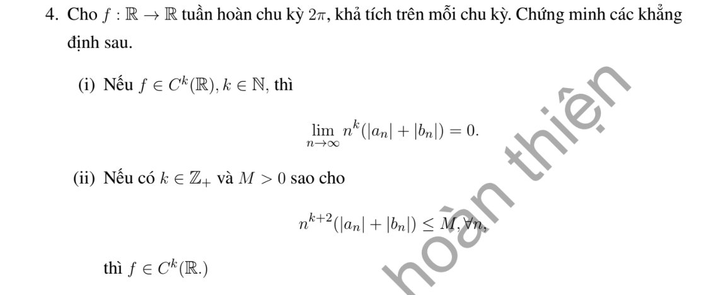

# Bài tập thực hành 4 — Mục 6.1.1.2

**Mã:** `BT_6_1_1_2_04` · **Trang sách:** 275–275

[← Mục lục](../MUC_LUC.md) · [Bản PDF của bài](BT_6_1_1_2_04.pdf)

## Đề bài

## Kiến thức và trình tự giải

**Bước 1 — Chốt quy ước.** Trên $[-L,L]$, dùng $f=a_0+\sum_{n\ge1}(a_n\cos(n\pi x/L)+b_n\sin(n\pi x/L))$, với

$$a_0=\frac1{2L}\int_{-L}^Lf,\quad a_n=\frac1L\int_{-L}^Lf\cos\frac{n\pi x}{L},\quad b_n=\frac1L\int_{-L}^Lf\sin\frac{n\pi x}{L}.$$

**Bước 2 — Tính hệ số.** Hàm chẵn chỉ có cosine, hàm lẻ chỉ có sine. Hàm phân đoạn phải chia tích phân tại điểm đổi biểu thức. Dùng tích thành tổng, tích phân từng phần hoặc chuỗi hình học/log để tính hệ số.

**Bước 3 — Hội tụ và giá trị ở mép.** Với dữ liệu trơn từng khúc, chuỗi về giá trị hàm tại điểm liên tục, về trung bình hai giới hạn tại điểm nhảy. Khai triển sine/cosine trên $[0,L]$ tương ứng thác triển lẻ/chẵn; giá trị ở đầu mút phải xét theo thác triển, không mặc nhiên bằng dữ liệu ban đầu. Hệ số suy đủ nhanh cho hội tụ đều bằng tiêu chuẩn Weierstrass.

## Lời giải áp dụng cho bài

**Ý (i).**  Tích phân từng phần $k$ lần, các hạng biên mất vì tuần hoàn; hệ số phức $\widehat f(n)=(in)^{-k}\widehat{f^{(k)}}(n)$. Bổ đề Riemann--Lebesgue cho $\widehat{f^{(k)}}(n)\to0$, nên $n^k(|a_n|+|b_n|)\to0$.

**Ý (ii).**  Giả thiết cho các chuỗi đạo hàm đến cấp $k$ được chặn bởi $M\sum n^{-2}$. Vì vậy tổng Fourier có đại diện $g\in C^k$, và $f=g$ hầu khắp nơi do tính duy nhất hệ số Fourier. Đề chỉ giả thiết $f$ khả tích nên không thể kết luận $f\in C^k$ tại mọi điểm: sửa một giá trị của $g$ không đổi bất kỳ hệ số nào nhưng có thể phá liên tục. Kết luận nguyên văn cần thêm giả thiết $f$ liên tục, hoặc hiểu $f$ như lớp tương đương hầu khắp nơi.

## Đối chiếu kết quả

Khi sử dụng kết quả, kiểm tra đồng thời phương trình, dữ liệu ban đầu/biên và miền được nêu trong lời giải. Các điều kiện về tính trơn, nghiệm thực, tồn tại hoặc duy nhất là một phần của kết luận; không bỏ chúng khi ghi đáp án.
