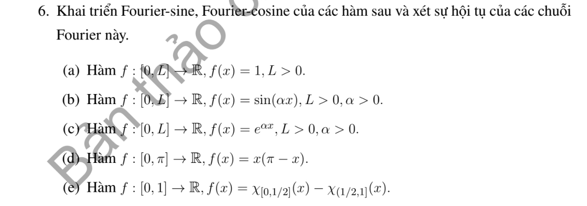

# Bài tập thực hành 6 — Mục 6.1.1.2

**Mã:** `BT_6_1_1_2_06` · **Trang sách:** 275–275

[← Mục lục](../MUC_LUC.md) · [Bản PDF của bài](BT_6_1_1_2_06.pdf)

## Đề bài

## Kiến thức và trình tự giải

**Bước 1 — Chốt quy ước.** Trên $[-L,L]$, dùng $f=a_0+\sum_{n\ge1}(a_n\cos(n\pi x/L)+b_n\sin(n\pi x/L))$, với

$$a_0=\frac1{2L}\int_{-L}^Lf,\quad a_n=\frac1L\int_{-L}^Lf\cos\frac{n\pi x}{L},\quad b_n=\frac1L\int_{-L}^Lf\sin\frac{n\pi x}{L}.$$

**Bước 2 — Tính hệ số.** Hàm chẵn chỉ có cosine, hàm lẻ chỉ có sine. Hàm phân đoạn phải chia tích phân tại điểm đổi biểu thức. Dùng tích thành tổng, tích phân từng phần hoặc chuỗi hình học/log để tính hệ số.

**Bước 3 — Hội tụ và giá trị ở mép.** Với dữ liệu trơn từng khúc, chuỗi về giá trị hàm tại điểm liên tục, về trung bình hai giới hạn tại điểm nhảy. Khai triển sine/cosine trên $[0,L]$ tương ứng thác triển lẻ/chẵn; giá trị ở đầu mút phải xét theo thác triển, không mặc nhiên bằng dữ liệu ban đầu. Hệ số suy đủ nhanh cho hội tụ đều bằng tiêu chuẩn Weierstrass.

## Lời giải áp dụng cho bài

Dùng $f=\sum b_n\sin k_nx$ và $f=a_0+\sum a_n\cos k_nx$, $k_n=n\pi/L$. Hệ số lần lượt $b_n=2L^{-1}\int_0^Lf\sin$, $a_n=2L^{-1}\int_0^Lf\cos$, $a_0=L^{-1}\int_0^Lf$.

**Ý (a).**  $b_n=2(1-(-1)^n)/(n\pi)$; cosine chỉ có $a_0=1$.

**Ý (b).**  $a_0=(1-\cos\alpha L)/(\alpha L)$,

$$
b_n=\frac{2(-1)^nk_n\sin\alpha L}{L(\alpha^2-k_n^2)},\quad a_n=\frac{2\alpha(1-(-1)^n\cos\alpha L)}{L(\alpha^2-k_n^2)}.
$$

Ở cộng hưởng lấy giới hạn; ví dụ $\alpha=k_N$ cho $b_N=1$, $b_n=0$ với $n\ne N$.

**Ý (c).**  $a_0=(e^{\alpha L}-1)/(\alpha L)$,

$$
b_n=\frac{2k_n(1-(-1)^ne^{\alpha L})}{L(\alpha^2+k_n^2)},\quad a_n=\frac{2\alpha((-1)^ne^{\alpha L}-1)}{L(\alpha^2+k_n^2)}.
$$

**Ý (d).**  $L=\pi$: $b_n=4(1-(-1)^n)/(\pi n^3)$, $a_0=\pi^2/6$, $a_n=-2(1+(-1)^n)/n^2$.

**Ý (e).**  $L=1$: $b_n=2[1+(-1)^n-2\cos(n\pi/2)]/(n\pi)$, $a_0=0$, $a_n=4\sin(n\pi/2)/(n\pi)$.

Sine là Fourier của thác triển lẻ chu kỳ $2L$, cosine là của thác triển chẵn. Tại điểm nội liên tục, cả hai về $f$; tại bước nhảy về trung bình hai phía. Sine luôn về 0 ở $0,L$, nên nếu $f$ không bằng 0 tại đó không có hội tụ đến giá trị biên. Cosine về giá trị biên một phía. Các cosine của (a)--(d) và sine của (b),(d) khi dữ liệu vanishes ở hai đầu có hội tụ đều nếu thác triển liên tục và các hệ số suy đủ nhanh; trường hợp bước nhảy (e) không đều. Các công thức hệ số chính xác ở trên cũng cho kiểm tra từng điều kiện biên.

## Đối chiếu kết quả

Khi sử dụng kết quả, kiểm tra đồng thời phương trình, dữ liệu ban đầu/biên và miền được nêu trong lời giải. Các điều kiện về tính trơn, nghiệm thực, tồn tại hoặc duy nhất là một phần của kết luận; không bỏ chúng khi ghi đáp án.
